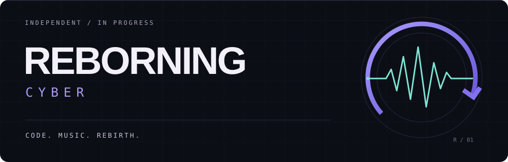

**Веб-разработка · Музыкальные продукты · Интерфейсы**

Создаю **Kaizeno** — пространство для поиска музыки, персонального радио и любимых треков.
Развиваюсь через реальные проекты: от идеи и интерфейса до работающего приложения.

[Проекты](#проекты) &nbsp; / &nbsp; [Технологии](#технологии) &nbsp; / &nbsp; [GitHub](https://github.com/REBORNING-cyber?tab=repositories)

---

### Сейчас в работе

**KAIZENO / Music discovery & personal radio**

Поиск, библиотека, плейлисты и непрерывный плеер. Работаю над персональным радио и тем, как музыка ощущается в интерфейсе.

`Next.js` `React` `TypeScript` `Fastify` `PostgreSQL`

Актуальная разработка ведётся в закрытом репозитории.

### Проекты

| Репозиторий | Доступ |
| :--- | :--- |
| [**kaizeno-v2 ↗**](https://github.com/REBORNING-cyber/kaizeno-v2) | Публичный репозиторий Kaizeno |
| [**music-project ↗**](https://github.com/REBORNING-cyber/music-project) | Публичный музыкальный проект |

### Технологии

**В текущем проекте**

`TypeScript` · `React` · `Next.js` · `Node.js` · `Fastify` · `PostgreSQL`

**Инструменты и практика**

`Git` · `GitHub` · `pnpm` · `Turborepo` · `Docker` · `Python`

Мне интересны музыкальные приложения, визуальный дизайн и удобное управление воспроизведением. Учусь на задачах, которые довожу до рабочего результата.

---

REBORNING / CODE · MUSIC · REBIRTH

